<p align="center">
  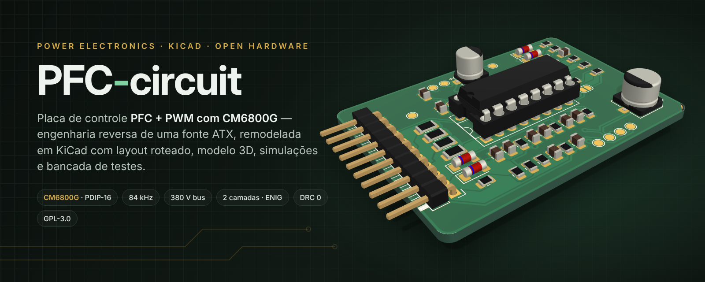
</p>

<p align="center">
  
  
  
  
  
  
</p>

<p align="center">
  <b>Controle de correção de fator de potência (PFC) + conversor PWM em uma placa-filha de 50 × 36 mm.</b><br>
  Engenharia reversa de uma fonte ATX, remodelada como projeto KiCad completo — esquemático, PCB roteada,<br>
  modelo 3D com componentes reais, arquivos de fábrica, simulações SPICE e uma bancada de testes dedicada.
</p>

---

## Sumário

- [Visão geral](#visão-geral)
- [Números do projeto](#números-do-projeto)
- [Arquitetura](#arquitetura)
- [Teoria de operação](#teoria-de-operação)
- [Interface PSH-BUS (J1)](#interface-psh-bus-j1)
- [As placas](#as-placas)
- [Lista de materiais](#lista-de-materiais)
- [Guia passo a passo](#guia-passo-a-passo)
- [Estrutura do repositório](#estrutura-do-repositório)
- [Limitações e pontos a confirmar](#limitações-e-pontos-a-confirmar)
- [Referências](#referências) · [Licença](#licença)

---

## Visão geral

Fontes de PC com PFC ativo costumam concentrar todo o controle em uma pequena placa vertical encaixada na placa de
potência. Este repositório parte da **PSH CARD1 REV 0.5** — uma dessas placas, levantada por engenharia reversa a partir
da peça física — e a transforma em um projeto de hardware aberto, reprodutível e documentado.

| Original (REV 0.5) | Remodelado (REV 1.0) |
|:---:|:---:|
| 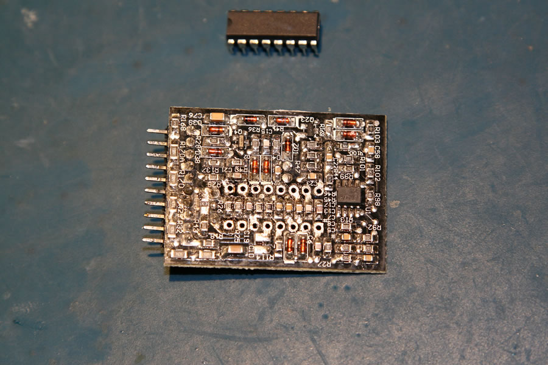 | 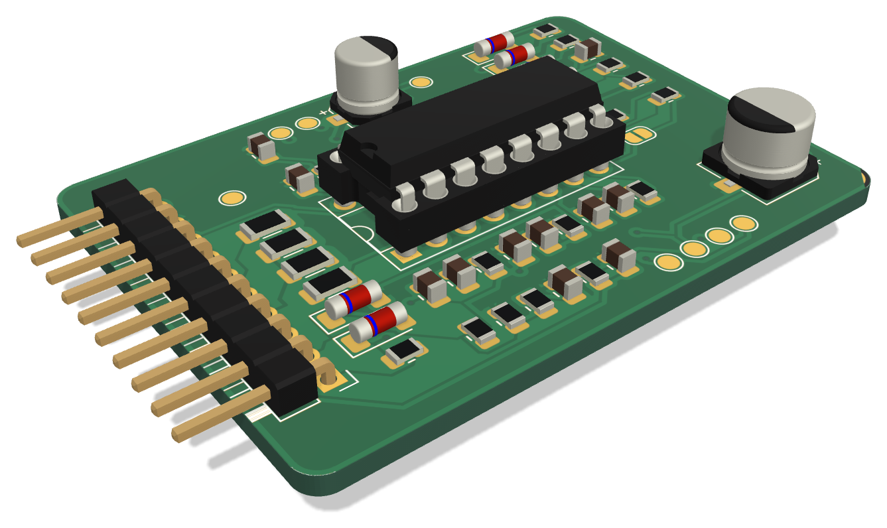 |
| Placa-filha retirada da fonte, com o CM6800G (DIP-16) removido do soquete | Modelo 3D gerado do KiCad com os modelos STEP reais dos componentes |
| 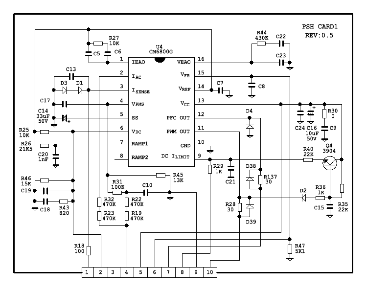 | 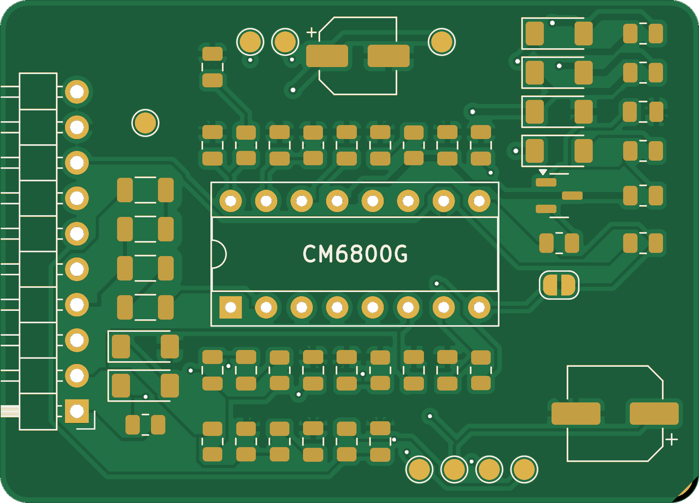 |
| Esquemático levantado (REV 0.5) | PCB de 2 camadas roteada, renderizada a partir dos Gerbers |

**O que há aqui:**

| | Conteúdo | Onde |
|---|---|---|
| ⚡ | Esquemático KiCad organizado em blocos funcionais, com netlist verificado automaticamente contra a fonte de verdade | [`hardware/psh-card1`](hardware/psh-card1) |
| 🟩 | PCB 50 × 36 mm, 2 camadas, roteada, planos de GND nas duas faces, **DRC 0** | [`psh-card1.kicad_pcb`](hardware/psh-card1/psh-card1.kicad_pcb) |
| 🧪 | **PSH-JIG1** — placa de bancada para energizar e testar a PSH-CARD1 em 12–15 V, sem rede elétrica | [`hardware/psh-jig1`](hardware/psh-jig1) |
| 🏭 | Gerbers X2, furação, BOM, pick-and-place, STEP, PDFs de esquemático e montagem | [`hardware/*/fab`](hardware/psh-card1/fab) |
| 🧊 | Modelos 3D (STEP/GLB/STL) e visualizador interativo three.js | [`docs/3d`](docs/3d) |
| 📈 | Cinco simulações ngspice dos sub-circuitos reais da placa, com gráficos | [`simulation`](simulation) |
| 🧮 | Calculadora de projeto: todos os pontos de operação a partir dos valores da placa | [`tools/pfc_calc.py`](tools/pfc_calc.py) |
| 🔁 | Pipeline 100 % reprodutível: um único arquivo Python descreve o circuito; o resto é gerado | [`tools/eda/designs.py`](tools/eda/designs.py) |

---

## Números do projeto

Valores calculados por [`pfc_calc.py`](tools/pfc_calc.py) e confirmados nas [simulações](simulation/RESULTS.md):

| Parâmetro | Valor | Origem |
|---|---|---|
| Frequência de chaveamento (PFC = PWM) | **83,9 kHz** (simulado: 82,6 kHz) | R26 = 21k5, C20 = 1 nF |
| Barramento PFC regulado | **380 V** (VFB = 2,50 V) | R47 = 5k1 + 770 kΩ na placa-mãe |
| Proteção de sobretensão do PFC | **418 V** (VFB = 2,75 V) | comparador interno |
| Liberação do PWM (VIN-OK) | **372 V** (VFB = 2,45 V) | comparador interno |
| VRMS @ 90 Vac / 230 Vac | **1,00 V / 2,56 V** | divisor 1053k : 13k |
| IAC de pico @ 264 Vac | **397 µA** | R32 + R23 = 940 kΩ |
| Soft-start do PWM | **1,15 s** até 0,7 V | 20 µA em C14 = 33 µF |
| Limite de corrente do PWM | **1,0 V** em DC ILIMIT (2,1 A com shunt de 0,47 Ω) | ciclo a ciclo |
| Compensação de rampa | **+114 mV** no pico (simulado: +109 mV) | Q4 · R35 · C15 · R40 |
| Gate — subida / descida (Ciss 2,2 nF) | **184 ns / 56 ns** | 30 Ω ∥ LL4148 |

---

## Arquitetura

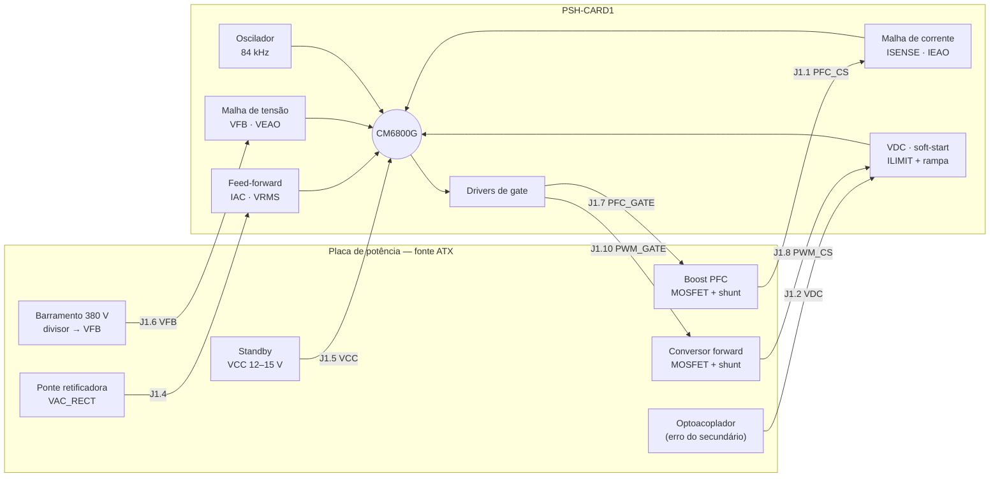

O **CM6800G** (Champion, pino a pino compatível com ML4800/FAN4800) reúne dois controladores sincronizados no mesmo
oscilador: um **PFC boost de corrente média com modulação na borda de subida** e um **PWM com modulação na borda de
descida**. Essa defasagem entre as bordas reduz a ondulação de corrente no capacitor do barramento — o PWM tende a
drenar energia enquanto o PFC a entrega.

<p align="center">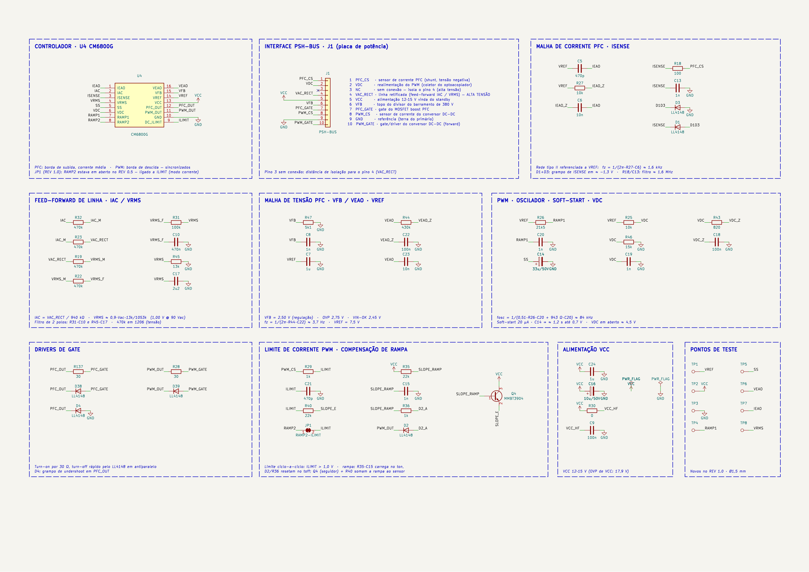</p>
<p align="center"><sub>Esquemático completo em blocos funcionais — <a href="docs/images/psh-card1-schematic.svg">SVG vetorial</a> · <a href="hardware/psh-card1/fab/psh-card1-schematic.pdf">PDF</a></sub></p>

---

## Teoria de operação

<details open>
<summary><b>1 · Oscilador (RAMP1)</b></summary>

RT = R26 (21k5, de VREF) e CT = C20 (1 nF, C0G) definem a rampa entre 1,25 V e 3,75 V; o tempo morto é a descarga de CT
por uma fonte interna:

$$t_{RAMP} = R_T C_T \ln\frac{V_{REF}-1{,}25}{V_{REF}-3{,}75} \approx 0{,}51\,R_T C_T = 10{,}97\ \mu s \qquad t_{DT} = 943\,\Omega \cdot C_T = 0{,}94\ \mu s$$

$$f_{osc} = \frac{1}{t_{RAMP}+t_{DT}} \approx 83{,}9\ \text{kHz}$$

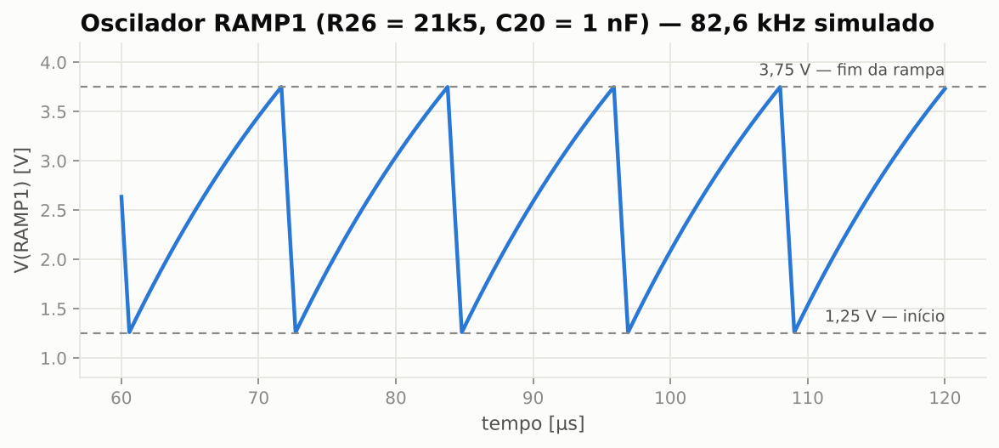
</details>

<details open>
<summary><b>2 · Feed-forward de linha (IAC e VRMS)</b></summary>

A linha retificada (`VAC_RECT`, J1.4) alimenta dois ramos:

- **IAC** — R32 + R23 = 940 kΩ convertem a forma de onda da linha em corrente (135 µA de pico @ 90 Vac): é o *formato* da
  corrente que o PFC vai copiar.
- **VRMS** — R19 + R22 (940 kΩ) → R31 (100 kΩ) → R45 (13 kΩ), com dois polos de filtro (C10 e C17, ≈ 3,4 Hz e 6,3 Hz):
  entrega o valor médio da linha, $V_{RMS} \approx 0{,}9\,V_{ac}\cdot\frac{13k}{1053k}$ — **1,00 V em 90 Vac**.

O modulador de ganho divide por $V_{RMS}^2$: a potência de entrada fica praticamente independente da tensão de linha,
e a malha de tensão não precisa "corrigir" mudanças de rede. Os quatro resistores de 470 kΩ estão em 1206 (200 V) e
receberam classe de rede **HV** com 0,6 mm de isolação no roteamento.

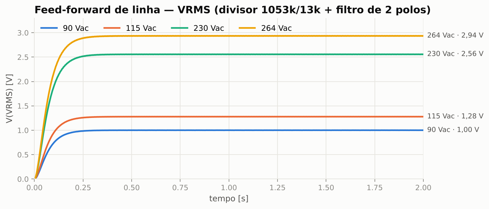
</details>

<details open>
<summary><b>3 · Malhas de controle do PFC</b></summary>

| Malha | Pino | Rede | Singularidades |
|---|---|---|---|
| Corrente (interna, rápida) | IEAO (1) | C5 ∥ (R27 + C6), referenciada a VREF | zero 1,59 kHz · polo 35,5 kHz |
| Tensão (externa, lenta) | VEAO (16) | C23 ∥ (R44 + C22) | zero 3,7 Hz · polo 40,7 Hz |

A malha de tensão é deliberadamente lenta (cruzamento abaixo da metade da frequência de linha) para não distorcer a
corrente de entrada a 100/120 Hz. Referenciar a rede da IEAO a VREF em vez de GND é equivalente em AC — VREF é uma
fonte de baixa impedância, desacoplada por C7. O sensor de corrente (ISENSE) recebe a tensão **negativa** do shunt via
filtro R18/C13 (≈ 1,6 MHz); D1 + D3 grampeiam excursões abaixo de ≈ −1,3 V.

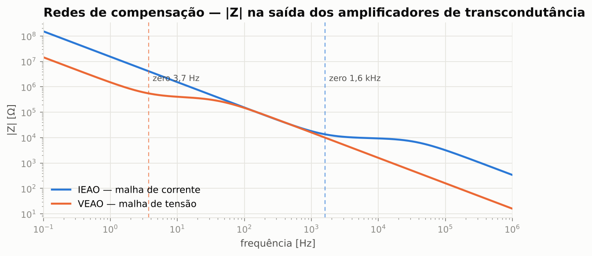
</details>

<details open>
<summary><b>4 · Seção PWM — realimentação, soft-start e limite de corrente</b></summary>

- **VDC (pino 6)** — R25 (10k, de VREF) e R46 (15k) fixam **4,5 V** com o optoacoplador cortado; o transistor do opto
  (J1.2) puxa VDC para baixo e reduz a razão cíclica. R43 + C18 e C19 dão a resposta em frequência.
- **Soft-start (pino 5)** — 20 µA carregam C14 (33 µF): o PWM começa em ≈ 0,7 V, **1,15 s** depois de o barramento passar
  por 2,45 V em VFB (VIN-OK). O conversor DC-DC só parte com o PFC já regulado.
- **DC ILIMIT (pino 9)** — limite ciclo a ciclo em 1,0 V, com filtro/blanking R29 + C21.

**Compensação de rampa (slope compensation).** Em modo corrente com razão cíclica alta, o laço é instável sem uma rampa
somada ao sinal do sensor (oscilação subharmônica). A placa resolve isso com quatro componentes discretos:

1. Durante o *t<sub>on</sub>* (PWM_OUT alto), D2 bloqueia e R35 carrega C15 a partir de VCC;
2. no *t<sub>off</sub>*, D2 + R36 descarregam C15 até o piso $V_f + (V_{CC}-V_f)\frac{R_{36}}{R_{35}+R_{36}} \approx 1{,}2$ V;
3. Q4 (MMBT3904, seguidor de emissor) copia a rampa sem carregar C15;
4. R40 (22k) soma a rampa ao nó ILIMIT, onde já chega o sinal do shunt por R29 (1k).

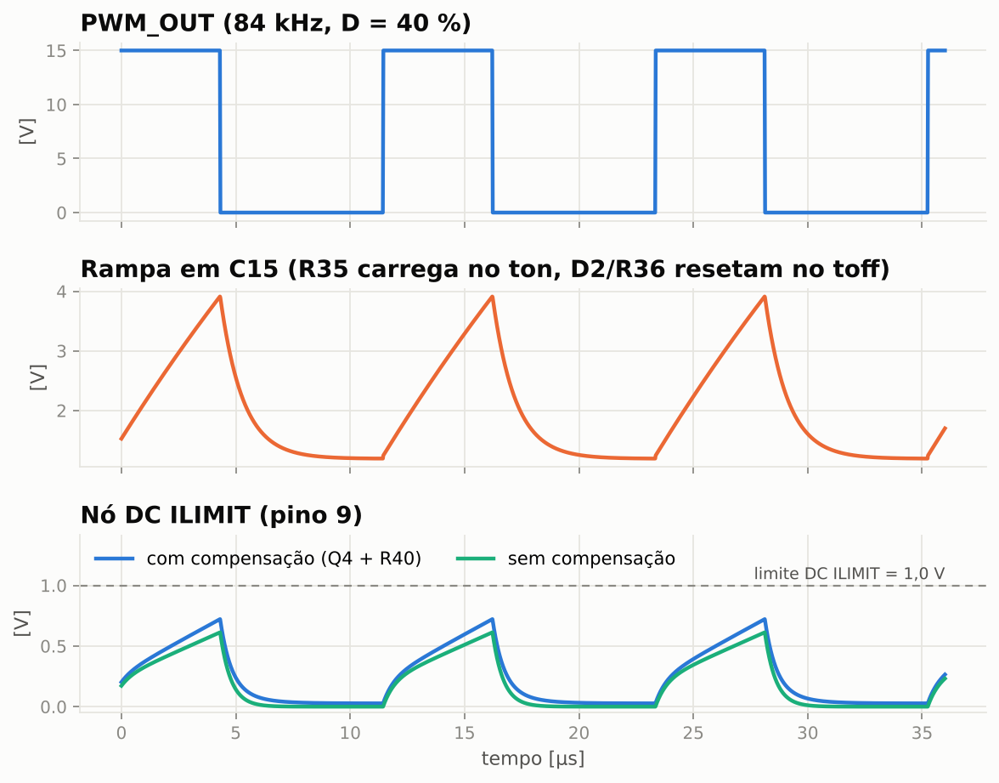
</details>

<details open>
<summary><b>5 · Drivers de gate</b></summary>

Cada saída usa a topologia clássica **resistor de turn-on + diodo de turn-off**: o gate carrega lentamente por 30 Ω
(menos EMI e menos *ringing* com a indutância do encapsulamento) e descarrega rápido pelo LL4148 em paralelo (menor
perda de comutação no desligamento). D4 grampeia o *undershoot* negativo em PFC_OUT.

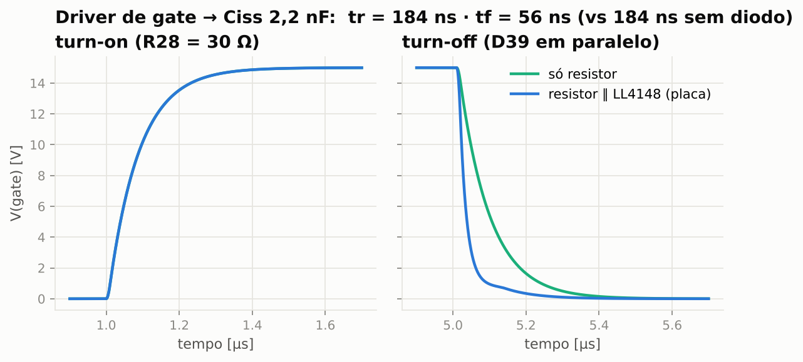
</details>

<details>
<summary><b>6 · Proteções do CM6800 usadas na placa</b></summary>

| Proteção | Limiar | Efeito |
|---|---|---|
| OVP do PFC | VFB > 2,75 V (418 V no barramento) | desliga PFC_OUT |
| VIN-OK | VFB < 2,45 V | mantém o soft-start do PWM descarregado |
| Limite de pico do PFC | ISENSE < −1,0 V | encerra o ciclo do PFC |
| Limite ciclo a ciclo do PWM | DC ILIMIT > 1,0 V | encerra o ciclo e descarrega o soft-start |
| OVP de VCC | VCC > 17,9 V | desliga as saídas |
| Limite de razão cíclica | < 50 % | evita saturação do transformador forward |

</details>

---

## Interface PSH-BUS (J1)

Barra de pinos 1 × 10, 2,54 mm, em ângulo reto — a placa fica em pé sobre a placa de potência.

| Pino | Rede | Direção | Descrição |
|:---:|---|:---:|---|
| 1 | `PFC_CS` | ← | Sensor de corrente do PFC (shunt, tensão negativa) |
| 2 | `VDC` | ← | Realimentação do PWM (coletor do optoacoplador) |
| 3 | — | | **Sem conexão** — distância de isolação para o pino 4 |
| 4 | `VAC_RECT` | ← | Linha retificada (IAC/VRMS) — ⚠️ **alta tensão** |
| 5 | `VCC` | ← | Alimentação 12–15 V vinda do standby |
| 6 | `VFB` | ← | Topo do divisor do barramento de 380 V |
| 7 | `PFC_GATE` | → | Gate do MOSFET boost |
| 8 | `PWM_CS` | ← | Sensor de corrente do conversor DC-DC |
| 9 | `GND` | | Terra do primário |
| 10 | `PWM_GATE` | → | Gate / driver do conversor forward |

---

## As placas

### PSH-CARD1 — controlador

<table>
<tr>
<td width="50%"></td>
<td width="50%">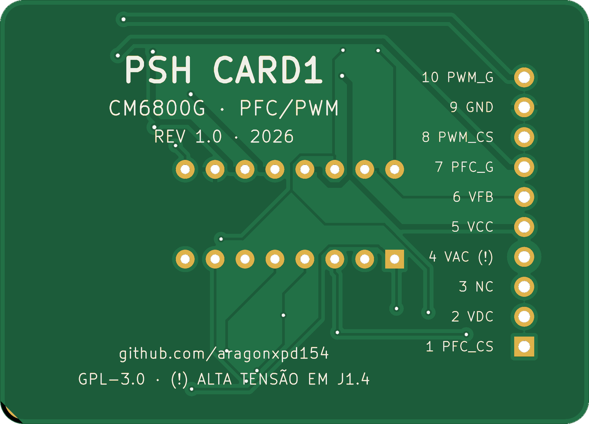</td>
</tr>
<tr><td align="center"><sub>Face superior (todos os SMD)</sub></td><td align="center"><sub>Face inferior — identificação e pinagem de J1</sub></td></tr>
<tr>
<td></td>
<td>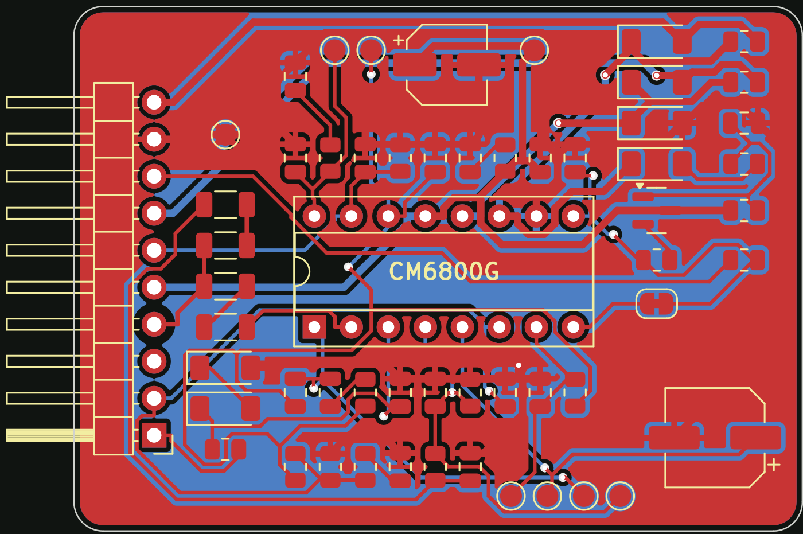</td>
</tr>
<tr><td align="center"><sub>Modelo 3D (modelos STEP reais)</sub></td><td align="center"><sub>Cobre: F.Cu (vermelho) · B.Cu (azul) · planos de GND</sub></td></tr>
</table>

| Característica | Valor |
|---|---|
| Dimensões | 50 × 36 mm, cantos com raio de 2 mm |
| Camadas | 2 · FR-4 1,6 mm · cobre 1 oz · ENIG |
| Montagem | SMD só na face superior (0805 / 1206 / MiniMELF / SOT-23), CI em soquete torneado DIP-16 |
| Regras | trilha/isolação 0,2 / 0,2 mm · via 0,6 / 0,3 mm · borda 0,4 mm |
| Classes de rede | `Power` 0,5 mm (VCC, GND, gates) · `HV` 0,6 mm de isolação (VAC_RECT, IAC_M, VRMS_M) |
| Roteamento | Freerouting + planos de GND nas duas faces com alívio térmico |
| Verificação | DRC 0 violações · 0 conexões pendentes · netlist = `designs.py` |

**O que mudou do REV 0.5 para o REV 1.0**

| Item | REV 0.5 (original) | REV 1.0 (este repositório) |
|---|---|---|
| RAMP2 (pino 8) | desenhado em aberto | **JP1** (jumper de solda, fechado) liga RAMP2 a ILIMIT — modo corrente, como na aplicação típica do datasheet |
| Pontos de teste | nenhum | **TP1–TP8**: VREF, VCC, GND, RAMP1, SS, VEAO, IEAO, VRMS |
| Resistores de alta tensão | — | 470 kΩ em 1206 (200 V) + classe `HV` no roteamento |
| CI | soldado em soquete | soquete torneado DIP-16 + modelo 3D do CI encaixado |
| Capacitores sem valor legível | — | valores **sugeridos** e justificados (ver abaixo) |

<details>
<summary><b>Valores sugeridos</b> — capacitores sem valor legível no esquemático original</summary>

| Ref. | Valor | Critério |
|---|---|---|
| C5 / C6 | 470 pF / 10 nF | zero da malha de corrente em 1,6 kHz, polo em 35 kHz (< f<sub>sw</sub>/2) |
| C7 | 1 µF | desacoplamento de VREF |
| C8 | 1 nF | filtro de ruído em VFB (polo ≈ 31 kHz com 5k1) |
| C9 / C24 | 100 nF / 1 µF | desacoplamento de VCC junto ao CI |
| C10 / C17 | 470 nF / 2,2 µF | filtro de 2 polos do VRMS (3,4 Hz / 6,3 Hz) — ondulação < 6 mV |
| C13 | 1 nF | filtro de ISENSE (1,6 MHz com 100 Ω) |
| C15 | 1 nF | τ = 22 µs ≫ período → rampa praticamente linear |
| C18 / C19 | 100 nF / 1 nF | rede de VDC (zero em 1,9 kHz) |
| C21 | 470 pF | blanking do ILIMIT (≈ 340 kHz com 1 kΩ) |
| C22 / C23 | 100 nF / 10 nF | zero da malha de tensão em 3,7 Hz, polo em 41 Hz |

Todos esses valores ficam marcados com `Nota = sugerido` no esquemático e na BOM. Se você tiver a placa original,
meça-os e atualize [`designs.py`](tools/eda/designs.py) — o pipeline regenera tudo.
</details>

### PSH-JIG1 — bancada de testes

<table>
<tr>
<td width="55%">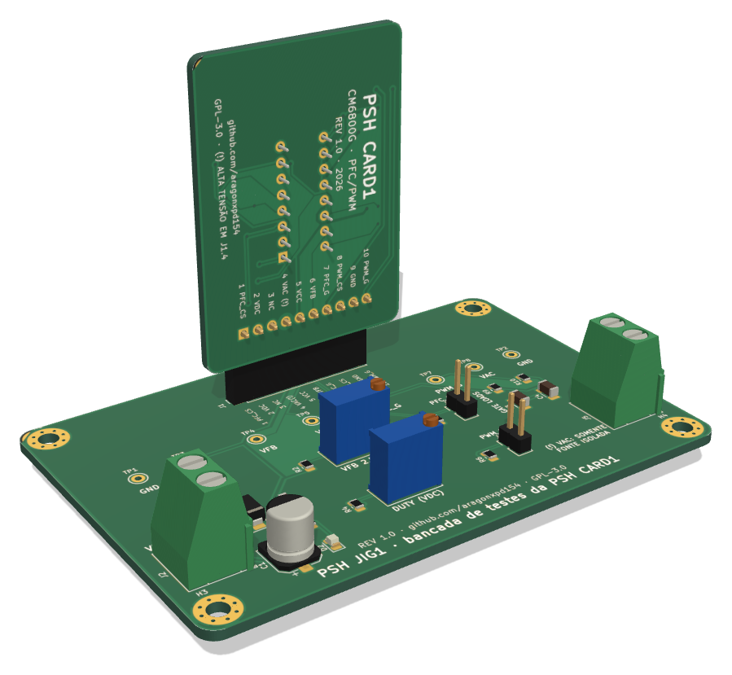</td>
<td width="45%">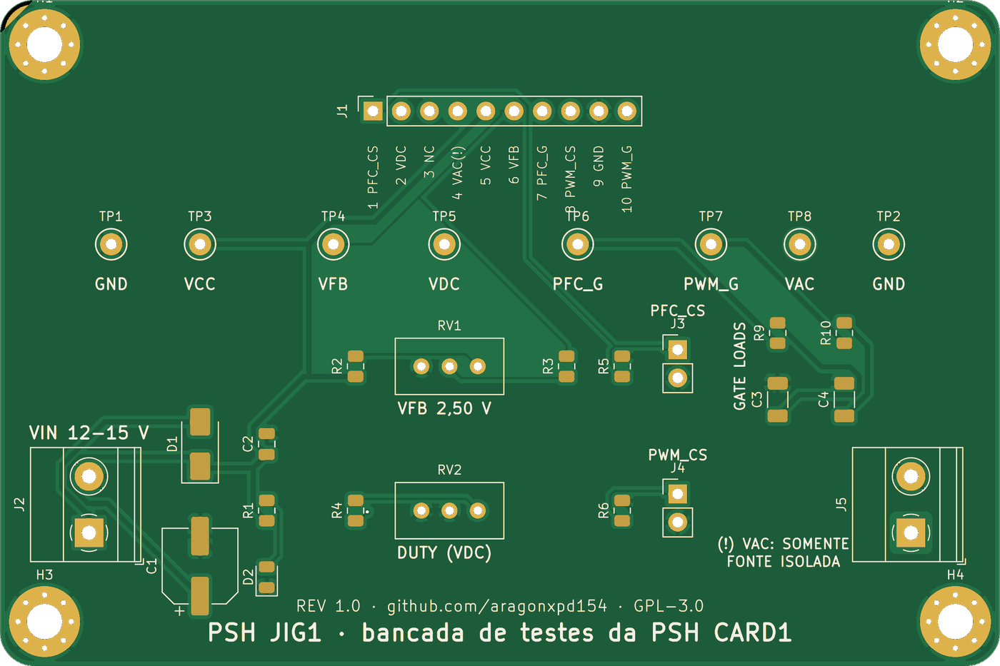<br><br>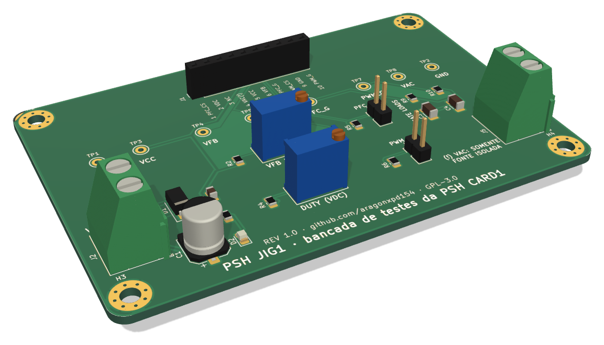</td>
</tr>
</table>

A PSH-JIG1 (90 × 60 mm) permite **energizar e validar a placa de controle com 12–15 V de bancada**, sem placa de
potência e sem tensão de rede:

| Bloco | Componentes | Função |
|---|---|---|
| Entrada | J2, D1 (SS34), C1, C2, LED D2 | 12–15 V com proteção contra inversão |
| Emulação do barramento | R2, **RV1**, R3 | ajusta VFB (2,50 V = 380 V regulado; 2,75 V = OVP) |
| Emulação do opto | R4, **RV2** | puxa VDC para baixo → controla a razão cíclica do PWM |
| Injeção de corrente | R5 + J3, R6 + J4 | gerador de funções em PFC_CS / PWM_CS (10 Ω de terminação) |
| Cargas de gate | R9/C3, R10/C4 | 10 Ω + 4,7 nF ≈ MOSFET de potência real |
| Linha (opcional) | J5 | VAC_RECT — **somente fonte DC isolada e limitada** |
| Medição | TP1–TP8 (Keystone) | ganchos para ponta de prova em todos os sinais relevantes |

> [!TIP]
> O visualizador 3D interativo ([`docs/3d/viewer.html`](docs/3d/viewer.html), arquivo único) abre offline em qualquer
> navegador: `make viewer`. Os arquivos [`psh-card1.stl`](docs/3d/psh-card1.stl) e [`psh-jig1.stl`](docs/3d/psh-jig1.stl)
> podem ser girados direto no GitHub.

---

## Lista de materiais

| Placa | Posições | Linhas de compra | Arquivos |
|---|:---:|:---:|---|
| PSH-CARD1 | 57 | 30 | [BOM](hardware/psh-card1/fab/psh-card1-bom.csv) · [por referência](hardware/psh-card1/fab/psh-card1-parts.csv) · [pick-and-place](hardware/psh-card1/fab/psh-card1-pos.csv) |
| PSH-JIG1 | 33 | 18 | [BOM](hardware/psh-jig1/fab/psh-jig1-bom.csv) · [por referência](hardware/psh-jig1/fab/psh-jig1-parts.csv) · [pick-and-place](hardware/psh-jig1/fab/psh-jig1-pos.csv) |

Semicondutores da PSH-CARD1: **CM6800GIP** (U4), **MMBT3904** (Q4), **6 × LL4148** (D1–D4, D38, D39).
O arquivo "por referência" lista a função de cada componente e suas conexões pino a pino.

---

## Guia passo a passo

### 0 · Pré-requisitos

| Ferramenta | Versão | Para quê |
|---|---|---|
| KiCad (+ footprints, símbolos, modelos 3D) | 7.0 ou superior | abrir/editar as placas, `kicad-cli` |
| Python | 3.10+ | calculadora, geradores, simulações |
| ngspice | 36+ | simulações |
| Java | 17+ | Freerouting (só para **re-rotear**) |
| Node.js | 18+ | visualizador 3D (opcional) |

Testado em **Ubuntu 24.04** (KiCad 7.0.11). Em **Zorin OS 17** / Ubuntu 22.04 o repositório padrão traz o KiCad 6 —
instale o 7 pelo PPA oficial antes do `make setup` (`sudo add-apt-repository ppa:kicad/kicad-7.0-releases`).
No Windows, use o WSL2, ou o KiCad nativo + o Python que acompanha o KiCad (que já traz o módulo `pcbnew`).

### 1 · Clonar e instalar

```bash
git clone https://github.com/aragonxpd154/PFC-circuit.git
cd PFC-circuit
make setup          # apt (KiCad, ngspice, Java), pip, Freerouting, three.js
make help           # lista todos os alvos
```

### 2 · Verificar o projeto

```bash
make check
```

```text
✓ card: 32 redes / 128 conexões idênticas ao designs.py
✓ psh-card1.kicad_pcb: DRC 0 violações, 0 não conectados
✓ jig: 16 redes / 63 conexões idênticas ao designs.py
✓ psh-jig1.kicad_pcb: DRC 0 violações, 0 não conectados
```

O esquemático é exportado pelo `kicad-cli`, o netlist resultante é comparado rede a rede com
[`designs.py`](tools/eda/designs.py), e o DRC roda nas duas placas. É o mesmo teste do CI
([`.github/workflows/hardware.yml`](.github/workflows/hardware.yml)).

### 3 · Calcular os pontos de operação

```bash
make calc
# ou com parâmetros da sua fonte:
python3 tools/pfc_calc.py --vbus 390 --rsense-pfc 0.05 --rsense-pwm 0.33 --vac 100 127 220
python3 tools/pfc_calc.py --json > operacao.json
```

```text
1 · Oscilador (RAMP1: RT = R26, CT = C20)
  t_RAMP = 0,51·RT·CT                       11 µs
  t_DEADTIME = 943 Ω·CT                     943 ns
  f_osc (PFC = PWM)                         83,9 kHz            (ML4800: 87,2 kHz)

3 · Barramento PFC (Vbus = 380 V, base do divisor R47 = 5k1)
  Resistor de topo necessário (placa-mãe)   770 kΩ
  OVP do PFC dispara em                     418 V
  PWM liberado (VIN-OK) em                  372 V
```

| Opção | Padrão | Significado |
|---|---|---|
| `--vbus` | 380 | tensão do barramento PFC [V] |
| `--vac` | 90 115 230 264 | tensões de linha para a tabela de IAC/VRMS [Vrms] |
| `--vcc` | 15 | alimentação do CI [V] |
| `--rsense-pfc` / `--rsense-pwm` | 0,1 / 0,47 | shunts da placa de potência [Ω] |
| `--ciss`, `--rg-int` | 2,2 nF, 2 Ω | MOSFET para o cálculo do driver |
| `--duty`, `--vcs-pk` | 0,40, 0,65 V | ponto de operação da compensação de rampa |

### 4 · Rodar as simulações

```bash
make sim            # ngspice + gráficos em docs/images + simulation/RESULTS.md
```

| Arquivo | O que simula |
|---|---|
| [`01_oscilador.cir`](simulation/01_oscilador.cir) | RT/CT com comparador de histerese e descarga de 2,65 mA |
| [`02_vrms.cir`](simulation/02_vrms.cir) | divisor + filtro de 2 polos com linha retificada de 90 a 264 Vac |
| [`03_rampa.cir`](simulation/03_rampa.cir) | gerador de rampa (Q4, D2, R35, R36, C15) somado ao ILIMIT |
| [`04_gate.cir`](simulation/04_gate.cir) | driver 30 Ω ∥ LL4148 em uma Ciss de 2,2 nF |
| [`05_compensacao.cir`](simulation/05_compensacao.cir) | \|Z\| das redes da IEAO e da VEAO (AC) |

Cada arquivo `.cir` roda sozinho: `cd simulation && ngspice 03_rampa.cir`.

### 5 · Abrir no KiCad

Abra [`hardware/psh-card1/psh-card1.kicad_pro`](hardware/psh-card1/psh-card1.kicad_pro) (ou a `psh-jig1`). O símbolo
do CM6800G vem de [`hardware/lib/PFC.kicad_sym`](hardware/lib/PFC.kicad_sym), já registrado na `sym-lib-table` do
projeto; footprints e modelos 3D são os das bibliotecas oficiais do KiCad. Esquemático e PCB estão vinculados pelos
UUIDs dos símbolos (os footprints carregam o caminho do símbolo correspondente).

### 6 · Modificar o circuito

Todo o projeto nasce de **um arquivo**: [`tools/eda/designs.py`](tools/eda/designs.py) (componentes, valores,
footprints, redes) mais [`pcb_layouts.py`](tools/eda/pcb_layouts.py) (posições). Para trocar um valor, por exemplo
deixar o oscilador em 65 kHz:

```python
R("R26", "28k", "VREF", "RAMP1", "RT do oscilador"),     # era 21k5
```

```bash
make sch            # regenera esquemáticos e confere o netlist
make pcb            # re-roteia (Freerouting) e roda o DRC
make fab            # Gerbers, BOM, STEP, PDFs
make render         # imagens e modelos 3D (opcional)
```

> [!NOTE]
> Prefere editar à mão no KiCad? Tudo bem — os arquivos `.kicad_sch`/`.kicad_pcb` são projetos KiCad normais.
> Só lembre que rodar `make sch`/`make pcb` depois sobrescreve as edições manuais.

### 7 · Fabricar as placas

Os pacotes prontos estão em `hardware/<placa>/fab/`:

1. Envie **`psh-card1-gerbers.zip`** ao fabricante (JLCPCB, PCBWay, etc.).
2. Parâmetros: **2 camadas · 1,6 mm · 1 oz · acabamento ENIG** (ou HASL sem chumbo) · máscara verde · serigrafia branca.
3. Para montagem SMT pelo fabricante, envie também `psh-card1-bom.csv` e `psh-card1-pos.csv`.
4. Repita para `psh-jig1-gerbers.zip`.

### 8 · Montar

1. Componentes baixos primeiro: resistores e capacitores 0805, depois 1206, MiniMELF e SOT-23 (Q4).
2. Confira a **polaridade dos diodos** (faixa = catodo) e dos eletrolíticos pelo desenho de montagem
   [`psh-card1-assembly.pdf`](hardware/psh-card1/fab/psh-card1-assembly.pdf).
3. Eletrolíticos C14 e C16 (o "+" da serigrafia). JP1 já vem fechado pelo próprio cobre — não corte.
4. Soquete DIP-16 (chanfro do lado do pino 1) e por último a barra de pinos 90° J1.
5. Antes de inserir o CM6800G: meça a resistência VCC–GND (> 1 kΩ) e a continuidade de cada pino de J1.

### 9 · Bring-up na bancada (PSH-JIG1)

Encaixe a PSH-CARD1 no soquete J1 da jig. Fonte de bancada **15 V, limite de 50 mA**, osciloscópio com referência em TP1.

| # | Ação | Medir em | Esperado |
|:---:|---|---|---|
| 1 | Ligar 15 V em J2 | TP3 (jig) | ≈ 14,6 V (queda do SS34) · consumo de algumas dezenas de mA · LED aceso |
| 2 | — | TP1 da card (VREF) | 7,5 V |
| 3 | — | TP4 da card (RAMP1) | dente de serra 1,25 → 3,75 V, ≈ 84 kHz |
| 4 | RV1 até **2,50 V** | TP4 da jig (VFB) | 2,50 V — barramento "regulado" |
| 5 | Aguardar ≈ 1 s | TP5 da card (SS) | rampa lenta a partir de 0 V |
| 6 | — | TP7 da jig (PWM_G) | pulsos de 84 kHz, razão cíclica < 50 % |
| 7 | Girar RV2 | TP7 da jig | razão cíclica diminui quando VDC desce |
| 8 | RV1 acima de **2,75 V** | TP7 da jig (PWM_G) | PWM continua — a OVP atua só na seção PFC |
| 9 | RV1 abaixo de **2,45 V** | TP7 da jig | PWM inibido (VIN-OK) |
| 10 | Pulso > 1 V em J4 | TP7 da jig | ciclo encerrado; soft-start descarrega |
| 11 | Comparar bordas | TP6 / TP7 | subida ≈ 180 ns, descida ≈ 60 ns ([simulação](docs/images/sim-gate.png)) |

> [!NOTE]
> Sem sinal em VAC_RECT, a seção PFC não tem referência de corrente (IAC = 0 e VRMS ≈ 0). A forma de onda em PFC_GATE
> nessa condição depende das proteções internas do CI — a validação principal do PFC acontece na placa de potência.

### 10 · Integração na fonte

> [!CAUTION]
> **A placa de potência opera com tensão de rede e com ~400 V DC no capacitor do barramento — risco de morte.**
> O pino 4 de J1 está ligado diretamente à linha retificada. Use **transformador isolador** e **variac**, uma lâmpada
> incandescente em série na primeira energização, ponta de prova diferencial (nunca aterre o osciloscópio no primário)
> e **descarregue o capacitor do barramento** antes de tocar em qualquer coisa. Se você não tem experiência com
> eletrônica de potência fora da rede, pare na etapa 9.

1. Confira o resistor de topo do divisor de VFB na placa-mãe com `pfc_calc.py --vbus <V>` (≈ 770 kΩ para 380 V).
2. Confira o shunt do PFC: o limite de pico é $1\,V / R_{sense}$.
3. Encaixe a PSH-CARD1, ligue pelo variac a partir de 0 V e suba devagar observando VFB e PFC_GATE.

---

## Estrutura do repositório

```text
PFC-circuit/
├── hardware/
│   ├── lib/PFC.kicad_sym           símbolo do CM6800G
│   ├── psh-card1/                  placa de controle (projeto KiCad)
│   │   ├── psh-card1.kicad_pro|sch|pcb
│   │   └── fab/                    gerbers/, *-gerbers.zip, BOM, posições, STEP, PDFs
│   └── psh-jig1/                   bancada de testes (mesma estrutura)
├── simulation/                     netlists ngspice, modelos, run_sims.py, RESULTS.md
├── tools/
│   ├── pfc_calc.py                 calculadora de projeto
│   ├── build_all.py                pipeline completo (make all)
│   ├── eda/                        designs.py (fonte da verdade), geradores de esquemático/PCB, verificação
│   └── render/                     texturas dos Gerbers, STEP→GLB/STL, visualizador 3D
├── docs/
│   ├── images/                     renders, esquemáticos, gráficos, fotos originais
│   └── 3d/                         viewer.html, *.glb, *.stl
├── scripts/setup-ubuntu.sh
├── Makefile · requirements.txt · LICENSE
└── .github/workflows/hardware.yml  CI: netlist + DRC + simulações + Gerbers
```

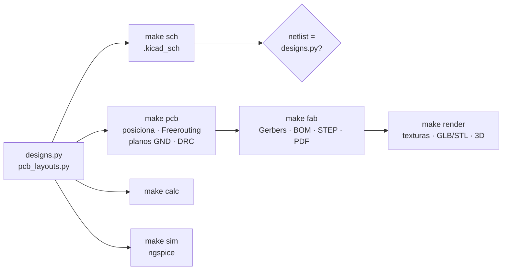

---

## Limitações e pontos a confirmar

Por ser uma reconstrução a partir de engenharia reversa, alguns pontos merecem conferência na placa física:

- **Capacitores sem valor** no REV 0.5 receberam valores sugeridos ([tabela](#psh-card1--controlador)); os resistores e
  os capacitores com valor legível (C14, C16, C20) foram mantidos exatamente.
- **RAMP2 (pino 8)** aparece em aberto no esquemático original. O REV 1.0 o liga a ILIMIT por JP1 (modo corrente);
  abrir JP1 reproduz o desenho original.
- **Q4** foi interpretado como seguidor de emissor (coletor em VCC, base na rampa de C15, emissor em R40) — é a única
  ligação que forma um gerador de compensação de rampa coerente com D2/R36/R35/C15.
- **Pino 3 de J1** não tem conexão no desenho; a interpretação adotada é a de distância de isolação para o pino de alta
  tensão.
- As simulações modelam o oscilador e os drivers do CM6800 de forma comportamental; os demais sub-circuitos usam os
  valores reais da placa e modelos SPICE de LL4148 e MMBT3904.

---

## Referências

- Champion Microelectronic — *CM6800 / CM6800A: Low start-up current PFC/PWM controller combo* (datasheet;
  pinagem, equações do oscilador, soft-start, VIN-OK e DC ILIMIT).
- [KiCad EDA](https://www.kicad.org) 7 — esquemático, PCB, `kicad-cli` e bibliotecas oficiais de footprints e modelos 3D.
- [Freerouting](https://github.com/freerouting/freerouting) — autoroteador Specctra.
- [ngspice](https://ngspice.sourceforge.io) — simulação de circuitos.
- [gerbonara](https://pypi.org/project/gerbonara/) · [OCP / OpenCascade](https://github.com/CadQuery/OCP) ·
  [three.js](https://threejs.org) — renderização e modelos 3D.

---

## Licença

Distribuído sob a **GNU GPL v3.0** — veja [`LICENSE`](LICENSE). Hardware fornecido "como está", sem garantias; o uso
com tensão de rede é de inteira responsabilidade de quem o monta.

<p align="center">
  <sub>Projeto de <b>Marcos Santos</b> · <a href="https://github.com/aragonxpd154">github.com/aragonxpd154</a></sub>
</p>
